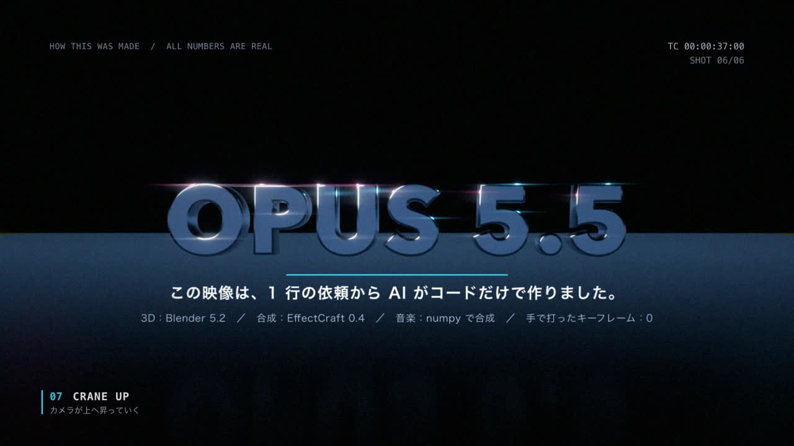
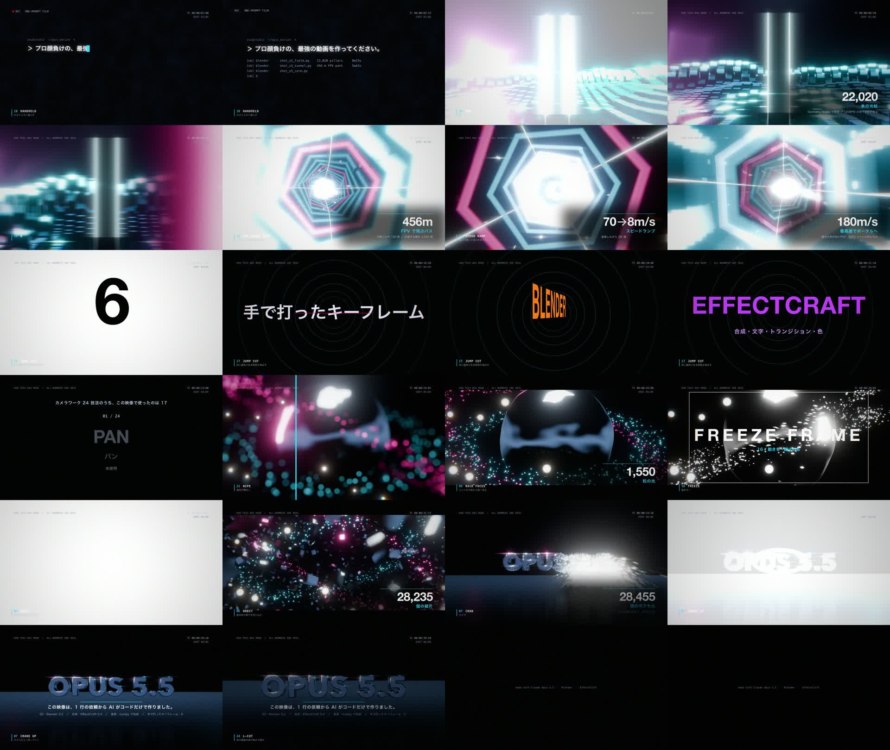
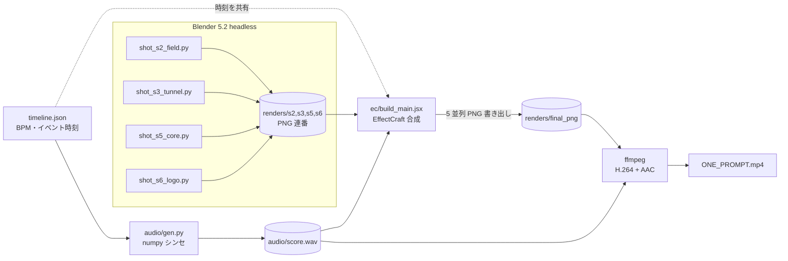

# ONE PROMPT — Opus 5.5 × Blender × EffectCraft



**1 行の依頼から、Claude Opus 5.5 がコードだけで作った 41.5 秒のモーショングラフィックス映像**と、その制作パイプライン一式です。
3D は Blender 5.2（ヘッドレス Python）、合成・文字・トランジションは EffectCraft 0.4（After Effects 互換の JSX）、音楽は numpy で合成しています。手で打ったキーフレームは 0 個です。

> 依頼文: 「プロ顔負けの最強な 30 秒から 1 分ぐらいの動画を作ってください」

- 制作の経緯・設計判断・ハマりどころ → **[docs/making-of.md](docs/making-of.md)**
- 再現手順の詳細 → **[docs/reproduce.md](docs/reproduce.md)**

## 映像の構成

120BPM（1 小節 = 2 秒）で、すべてのカットがビートに同期しています。画面の数字はすべて Blender / EffectCraft から計測した実測値です。

| 時間 | ショット | 担当 | 画面の文字（実測値） | チートシートの技法 |
|---|---|---|---|---|
| 0–4s | S1 ターミナル | EffectCraft | 実際の依頼文と、実行したコマンドのログ | 10 手持ち風 / 23 J カット |
| 4–10s | S2 光柱フィールド | Blender GN | 22,020 本の光柱 / 18→96mm | 22 スマッシュカット / 08 ドリーズーム |
| 10–16s | S3 FPV トンネル | Blender GN | 456m / 70→8m/s / 180m/s | 19 ホイップパン / 11 FPV / 14 スピードランプ / 12 ダッチアングル |
| 16–24s | S4 キネティックタイポ | EffectCraft | 1行 → 6 ショット → 4 ツール → 1,245 フレーム → 手で打ったキーフレーム 0 | 18 マッチカット / 17 ジャンプカット / 21 ワイプ |
| 24–32s | S5 クロムコア | Blender GN | 1,550 粒 / 270° / 28,909 個の破片 | 06 オービット / 09 ラックフォーカス / 16 フリーズフレーム |
| 32–41.5s | S6 ロゴ集合 | Blender GN + EffectCraft | 28,455 個のボクセル | 20 クロスディゾルブ / 07 クレーンアップ / 24 L カット |



## パイプライン



## クイックスタート

必要なもの: macOS（Apple Silicon で確認）、Blender 5.2、EffectCraft CLI 0.4、ffmpeg、[uv](https://docs.astral.sh/uv/)

```bash
# 1. 音楽を合成（audio/score.wav）
uv run --with numpy --with scipy python audio/gen.py

# 2. Blender で 3D ショットをレンダリング（M5 で計 41 分）
./render_queue.sh shot_s2_field.py shot_s3_tunnel.py shot_s5_core.py shot_s6_logo.py

# 3. EffectCraft で合成 → 5 並列で書き出し → ffmpeg で mp4 に結合
./render_final.sh
```

ツールの場所が既定値と違う場合は、環境変数 `BLENDER` / `EFFECTCRAFT_CLI` で指定します。詳しくは [docs/reproduce.md](docs/reproduce.md) を参照してください。

## ディレクトリ構成

```
.
├── timeline.json          # BPM・ショット区間・イベント時刻（音と映像で共有）
├── audio/gen.py           # BGM と効果音の合成（120BPM, A minor）
├── blender/
│   ├── common.py          # シーン初期化・マテリアル・GN ヘルパー・コンポジタ
│   ├── shot_s2_field.py   # 光柱フィールド＋ドリーズーム
│   ├── shot_s3_tunnel.py  # FPV トンネル＋スピードランプ
│   ├── shot_s5_core.py    # クロムコア＋オービット＋爆散
│   ├── shot_s6_logo.py    # ボクセル集合ロゴ＋クレーンアップ
│   ├── stats.py           # 画面に出す実数（インスタンス数・速度）の計測
│   └── probe.py           # Blender 5.2 の API 調査用
├── ec/
│   ├── build_main.jsx     # EffectCraft のコンポ構築（S1/S4/HUD/データカード/グレード）
│   └── count_keys.jsx     # プロジェクト内のキーフレーム総数を数える
├── render_queue.sh        # Blender ショットを順番に本番レンダリング
├── render_final.sh        # EffectCraft 並列書き出し → ffmpeg エンコード
└── docs/                  # ドキュメントと画像
```

レンダー結果（約 5.7GB）、mp4、wav、`.ecproj` はすべてスクリプトから再生成できるため、リポジトリには含めていません（`.gitignore` 参照）。

## ライセンス・クレジット

- 3D: [Blender](https://www.blender.org/) 5.2.2 LTS
- 合成: [EffectCraft](https://github.com/storytold/effectcraft) 0.4.0（MIT / Apache-2.0）
- フォント: macOS 標準のヒラギノ角ゴシック、Helvetica Neue、Avenir Next、Menlo
- 監督・コード・作曲・編集: Claude Opus 5.5（依頼と監修: [@dhythm](https://github.com/dhythm)）
