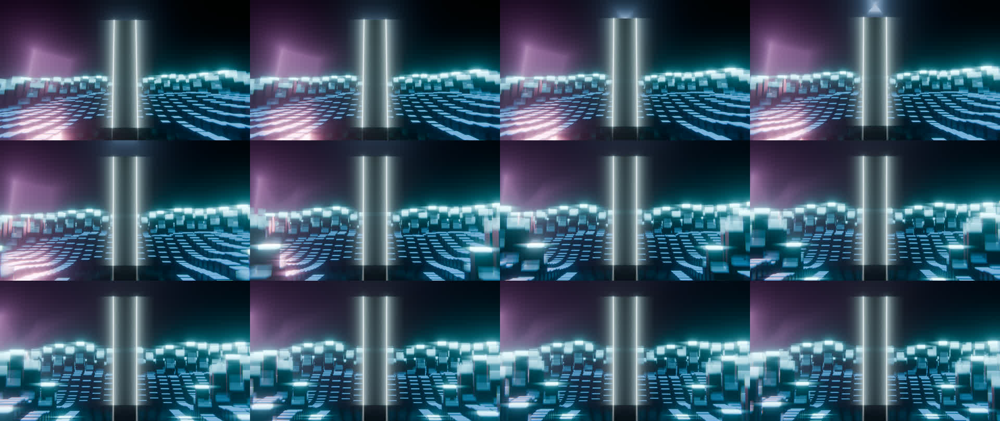
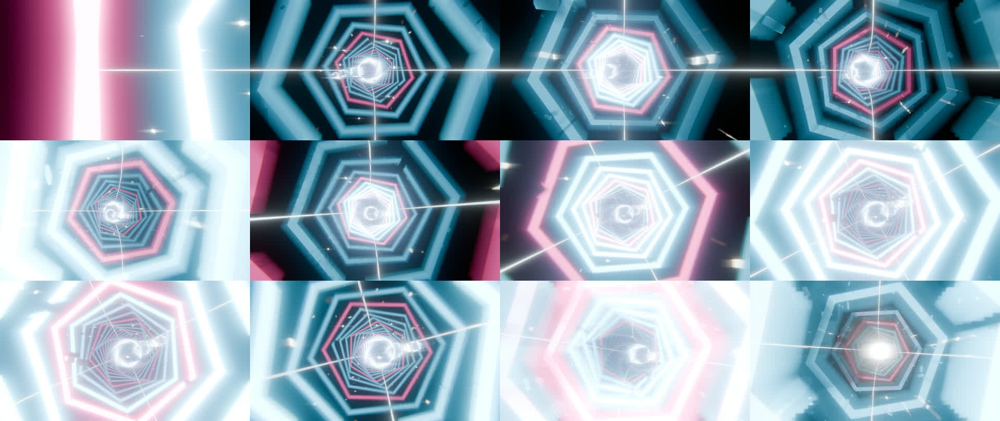
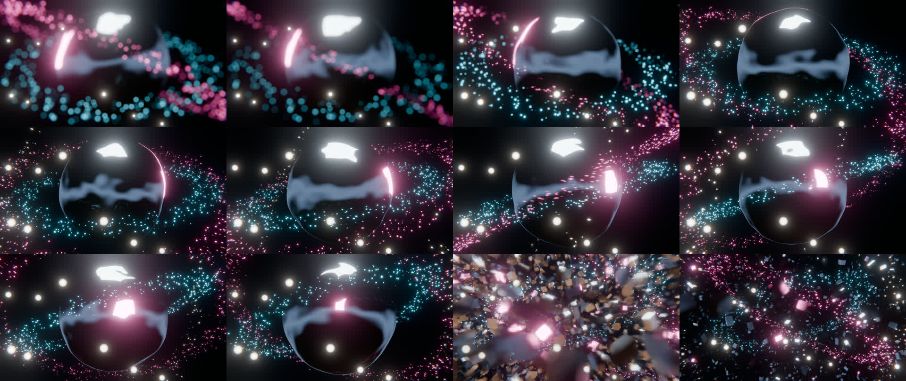
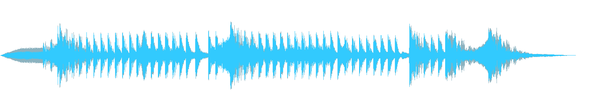
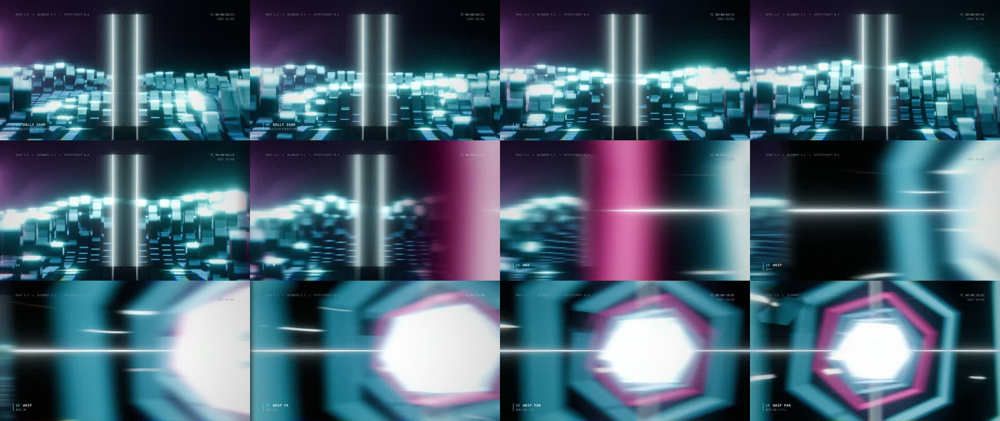
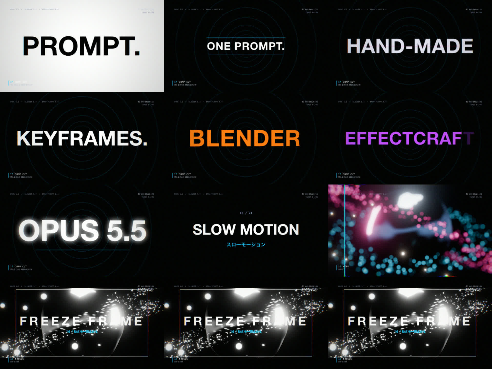
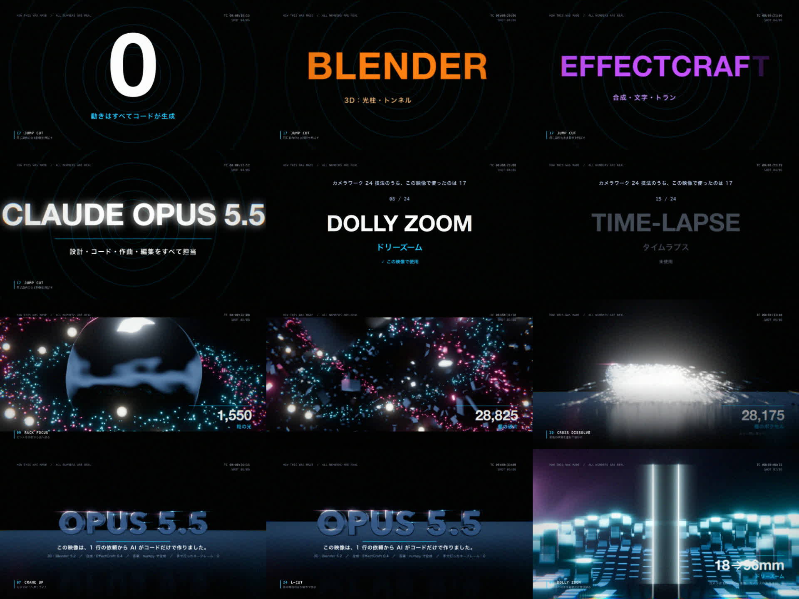
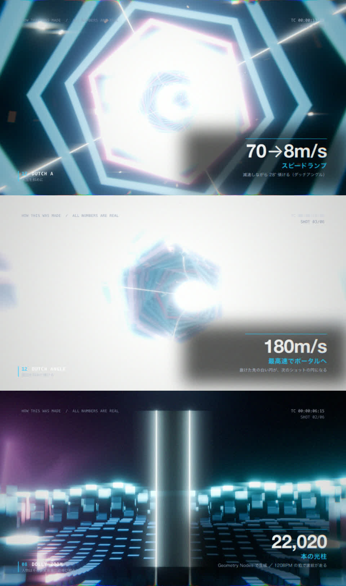

# メイキング — この映像はどうやって作ったか

1 行の依頼から完成までを、実際の作業順に記録します。所要時間は約 75 分（18:50 着手 → 20:03 最終エンコード、途中の文字の作り直しを含む）でした。マシンは Apple M5（10 コア）です。

---

## 0. 依頼と前提

> Opus 5.5 × Blender × After Effects を組み合わせればすごい動画が作れます。
> After Effects は持っていないが、互換で MCP も使える EffectCraft がある。Blender と EffectCraft は MCP 経由で操作できる。
> これらのスタックで、プロ顔負けの最強の 30 秒〜1 分の動画を作ってください。

参考資料として、カメラワークと切り替えのチートシート（24 技法）が添えられていました。

## 1. 環境の調査（MCP が見えなかったので CLI に切り替える）

最初に、このセッションで使える MCP ツールを検索しました。Blender と EffectCraft の MCP は見つかりませんでした。調べると、MCP の設定は Codex 側（`~/.codex/config.toml`）にしかありませんでした。

アプリ本体はインストールされていたので、次の方法で直接操作することにしました。

| ツール | 操作方法 | 理由 |
|---|---|---|
| Blender 5.2.2 | `Blender -b --factory-startup -P script.py`（ヘッドレス Python） | `bpy` を直接使えるので、MCP より細かく制御できる |
| EffectCraft 0.4.0 | `effectcraft-cli script build.jsx`（After Effects 互換の JSX） | MCP サーバーと同じエンジンで、655 コマンドと 306 エフェクトがすべて使える |

> その後、Claude Code の user スコープにも `blender` / `effectcraft` / `vectorcraft` / `photocraft` / `filmcraft` の MCP を登録しました。次のセッションからは MCP 経由でも操作できます。

## 2. API を実際に叩いて確認する

推測で大きなスクリプトを書くと、丸ごと壊れるおそれがあります。そこで、先に小さな probe スクリプトで次の点を確かめました。

- **Blender 5.2**：
  - エンジン名は `BLENDER_EEVEE`
  - コンポジタは `scene.compositing_node_group` から設定する
  - Glare ノードに `Bloom` がある
  - ヒラギノの `.ttc` も読み込める
  - Geometry Nodes のノード型は 274 種類
- **EffectCraft**：
  - テキストのプロパティは `ADBE Text Properties > ADBE Text Document`
  - テキストアニメーターの Range Selector は `start` / `end` / `offset`
  - エフェクトの matchName は一覧で確認（Glow は `ADBE Glo2`、色収差は `ec.vr.chromaticaberrations`）
  - PNG 連番の読み込みとタイムリマップが動くことを確認

## 3. 設計 — 時刻表を 1 つに決める

`timeline.json` に BPM（120）、各ショットの区間、イベントの時刻（インパクト、ホイップ、スロー区間、フリーズ、爆発、ロゴヒット）を書きました。音（`audio/gen.py`）も映像（Blender と EffectCraft）もこの時刻表に合わせて作るので、カットとビートが必ず揃います。

ショットごとに、チートシートの技法を最低 1 つ割り当てました（README の表を参照）。最終的に 24 技法のうち 17 を本編で使っています。

## 4. Blender — 4 つの 3D ショット

共通処理は `blender/common.py` にまとめ、ショットごとに独立したスクリプトにしました。1 ショットだけ直して再レンダリングできるようにするためです。

### 進め方：静止画で詰めてから本番

1. フル解像度で 1 フレームだけレンダリングし、時間を測る（S2 は 1 フレーム約 7 秒）
2. `--still N --preview`（1/3 解像度）で 3〜4 フレームを並べたコンタクトシートを作り、**画像を実際に見て**判断する
3. 問題がなくなったら `render_queue.sh` で本番を順番にレンダリングする。待っている間に次のショットを書く

### S2 光柱フィールド（ドリーズーム）

- Grid（150×150）→ Instance on Points で立方体を **22,020 本**並べる
- 高さ = 4D ノイズ ＋ `cos(距離×0.9 − 4πt)` を鋭くした波紋。4πt は 2Hz、つまり 120BPM の拍ごとに中心から波紋が出る
- カメラは 18mm・6m から 96mm・32m へ移動する。距離 / 焦点距離の比を一定に保つので、モノリスの大きさは変わらず、背景だけが圧縮される（ドリーズーム）
- **ハマりどころ**
  - 霧が濃すぎて全体が白飛びした
  - 柱がモノリスを隠した → カメラの通路を GN でくり抜いた
  - 柱の上端だけを光らせたかったが、インスタンスでは `Generated` 座標が効かなかった → 立方体のローカル Z を名前付き属性 `lz` として保存し、シェーダーで読んだ

### S3 FPV トンネル（スピードランプ / ダッチアングル）

- S 字のベジェパス（**456m**）→ Resample で 120 点 → 接線に揃えた六角リングを並べ、index に比例して少しずつねじる
- リングの発光は、2Hz のパルスが奥へ走るように設定した
- パスの法線と従法線方向に 4 本の光のレールを引き、周囲に 2,500 個の金属片を浮かべた
- カメラリグは「Follow Path の Empty → ヨーとロール用の Empty → カメラ」の 3 段構成。回転順の干渉を避けるためで、1 段にまとめたときはカメラが横を向いて真っ白になった
- 速度は **約 70m/s → 8m/s（スロー、28° ロール）→ 最高 180m/s**。Follow Path のオフセットをキーフレームで動かしている
- 出口の白いポータルが、次のショットの白い円につながる（マッチカット）

### S5 クロムコア（オービット / ラックフォーカス / 爆散）

- Icosphere（subdiv 6）を 4D ノイズで変形させ、拍に合わせて脈打たせる。マテリアルは thin film の玉虫色クロム
- 黒い空間ではクロムに何も映らない → 地平線だけが明るいグラデーションのワールドを作った（Light Path でカメラには暗く見せる）
- 3 本の粒子リング（**計 1,550 粒**）が別々の速度で公転する
- カメラは 270° オービットしながら、f/1.2 でピントを 2.4m（手前の粒子）から 9m（コア）へ送る
- GN 入力 `Explode` をキーフレームで動かし、表面から生成した **28,909 個**の破片を法線方向に飛ばす
- **ハマりどころ**：Blender 5.x では GN モディファイアの入力が IDProperty ではなくなった。`mod.properties.inputs.Socket_1.value` に値を入れてキーを打つ

### S6 ロゴ集合（クレーンアップ）

- 3D テキスト「OPUS 5.5」をメッシュ化し、面上に **28,455 個**のボクセルを配置する
- 各ボクセルの遅延 = x 座標による左→右の順番 ＋ 乱数。進行度に ease-out cubic をかけ、散らばった位置から元の位置へ集める。到着の瞬間だけ発光させる
- 34.0 秒（拍）で Switch ノードを使って実体のメッシュに切り替え、同時にフラッシュと衝撃波を入れる
- カメラは低い位置から正面へ上がる（クレーンアップ）

## 5. 音 — numpy で作曲する

`audio/gen.py` で、キック、スネア、ハイハット、ベース、スーパーソウのパッド、スタブ、プラック、インパクト、ライザー、whoosh、タイプ音、グリッチを合成しました。

- サイドチェインでパッドとベースをダッキングし、ホールリバーブは畳み込みで作った
- **J カット**：S2 の鼓動が 3.0 秒から先に鳴る
- **スロー区間**：ローパス＋深いリバーブ
- **フリーズ**：直前にテープストップ → 0.5 秒の無音
- **L カット**：映像の暗転後も 1.5 秒余韻を残す
- **ハマりどころ**：区間ごとにフィルターを掛け直すとき、フィルター状態をリセットしていたため、境目にジッパー状のノイズが乗った → `sosfilt(..., zi=zi)` で状態を引き継いで解消した

## 6. EffectCraft — 合成と文字

`ec/build_main.jsx` 1 本で、プロジェクト全体を組み立てます。

- **S1（ターミナル）**：依頼文をタイプライター表示し、カーソルはエクスプレッションで追従させる。続いて実行ログ → グリッチ（Turbulent Displace ＋ 色収差のホールドキー）→ ズームブラーでスマッシュカット
- **S4（キネティックタイポ）**：ヒットのたびに文字を切り替える（ジャンプカット）。白地反転、取り消し線、文字単位のランダム落下、3D 回転、CC Particle World、CC Light Sweep を使った
- **トランジション**：
  - ホイップパン：S2 が左へ抜け、同時に S3 が右から入る。方向ブラーとモーションブラーを併用
  - マッチカット：S3 をタイムリマップしてポータルが円に見える最後のフレーム（f172）で切り、S4 の白い円（直径 560px）につなぐ
  - ワイプ：Linear Wipe と光るエッジ
  - クロスディゾルブ
- **フリーズフレーム**：タイムリマップのホールド、彩度 −100、ブラケット枠
- **HUD**：左下に、使っている技法の番号・英名・日本語の説明をその瞬間に表示する。右上にタイムコード（エクスプレッション）
- **仕上げ**：シェイク（インパクト時刻からの減衰エクスプレッション）、グレード（コントラスト・彩度・色収差・ビネット・グレイン）、レターボックス

### EffectCraft で見つけた落とし穴

1. **キーフレームはフレームに丸められる**。`3.99` と `4.0` は同じフレームになり上書きされる。そのためフラッシュの補間が 4.25 秒から 28 秒までの間で膨らみ、画面全体に灰色のベールがかかった。レイヤーを 1 枚ずつ無効化して原因を特定し、`kf()` ヘルパーでキーの衝突を回避して直した

   
   *左から：全レイヤー / grade 無効 / shake 無効 / **flash 無効（ここだけ正常）** / HUD 無効*

2. **相対パスは `.ecproj` のある場所を基準に解決される**。書き出し先が `ec/renders/...` になっていた → 絶対パスで指定する
3. matchName が AE と一部違う：
   - 回転は `ADBE Rotate Z`
   - リピーターは `ADBE Vector Position` / `endOpacity`
   - Tracking Amount は、追加したあと名前で取り直す必要がある
4. H.264 の直接書き出しは 1 フレーム約 2.2 秒と遅い → PNG 連番を 5 並列で書き出し、ffmpeg で結合した（約 9.5 分）

## 7. フィードバックで文字を作り直す（v1 → v2）

v1 では「`claude --model opus-5.5`」「ONE PROMPT. ZERO HAND-MADE KEYFRAMES.」「BLENDER × EFFECTCRAFT × OPUS 5.5」のように、道具の名前を並べていました。これに対して、次のフィードバックを受けました。

> 意味のない文字を出してるだけに見える。せっかく動画を作るなら、意味がある文字を出したい。

方向性を確認したうえで、**「メイキングの種明かし」**に作り直しました。

- 画面の数字はすべて実測値にする
  - `blender/stats.py`：評価済みの depsgraph からインスタンス数を数え、パス長と速度を計算する
  - `ec/count_keys.jsx`：プロジェクト内の全キーフレーム（672 個）を数える
  - レンダリング時間はログから取る
- 右下のデータカードで、各ショットの「何を・いくつ・どう作ったか」を示す
- S4 は事実だけで構成する：1行の依頼 → 6 ショット → 4 ツール → 1,245 フレーム → 手で打ったキーフレーム 0 → 各ツールの役割
- モンタージュでは 24 技法を流し、本編で使った 17 個だけを点灯させる
- エンディングは「この映像は、1 行の依頼から AI がコードだけで作りました。」

| v1（道具名の羅列） | v2（実測値の種明かし） |
|---|---|
|  |  |

明るい背景ではデータカードが読めなかったので、ぼかした暗い下敷きを追加しました。

## 8. 検証

- つなぎ目（4.0 / 10.0 / 16.0 / 24.0 / 28.0〜28.5 / 31〜32.5 / 34 / 39〜41.5 秒）のフレームを書き出し、コンタクトシートで目視した
- `render_final.sh` でガードする
  - 素材のフレーム数（180 / 180 / 240 / 240）を確認してからビルドする
  - 書き出し後に 1,245 フレームが欠番なくそろっているか確認する
- `ffprobe` で長さ 41.5 秒と音声ストリームを確認した。`volumedetect` でピーク −1.3dB を確認した
- 音は聴いて確認していません（AI は音を聴けないため、波形とレベルのみ確認）

## 数字のまとめ（すべて実測）

| 項目 | 値 | 出どころ |
|---|---|---|
| 光柱 | 22,020 本 | `stats.py`（S2 のインスタンス数） |
| トンネルのパス長 | 456.2m | `stats.py`（評価済みカーブの長さ） |
| リング / 破片（S3） | 120 枚 / 2,500 個 | GN の設定値 |
| 速度 | 約 70m/s → 8m/s → 最高 180m/s | `stats.py`（Follow Path のオフセットの微分 × パス長） |
| 粒子（S5） | 1,550 粒 | GN の設定値（500＋700＋350） |
| 爆散の破片 | 28,909 個 | `stats.py`（爆散後のインスタンス数 − 粒子数） |
| ボクセル | 28,455 個 | `stats.py`（S6 のインスタンス数） |
| EffectCraft のキーフレーム | 672 個（すべてコードで生成） | `count_keys.jsx` |
| Blender のレンダリング時間 | 41 分（8m23s＋5m43s＋10m34s＋16m14s） | `render_queue.sh` のログ |
| 総フレーム数 | 1,245（41.5 秒 × 30fps） | — |
